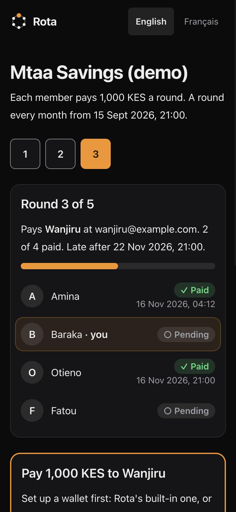
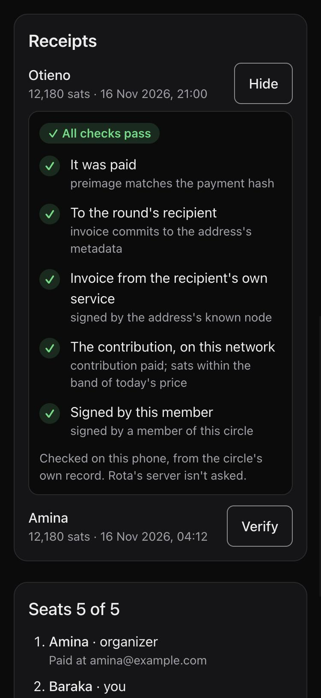
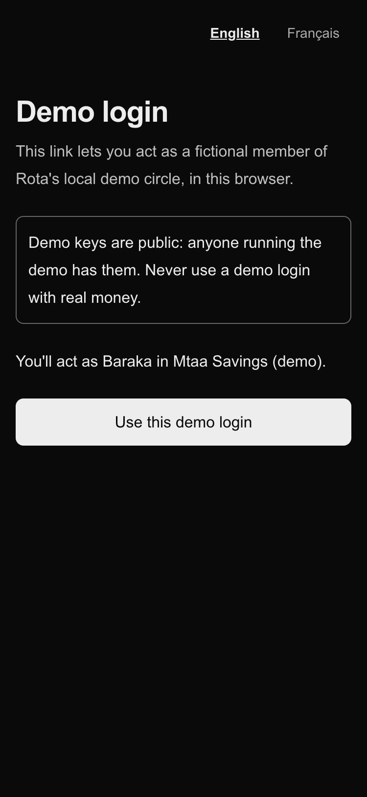
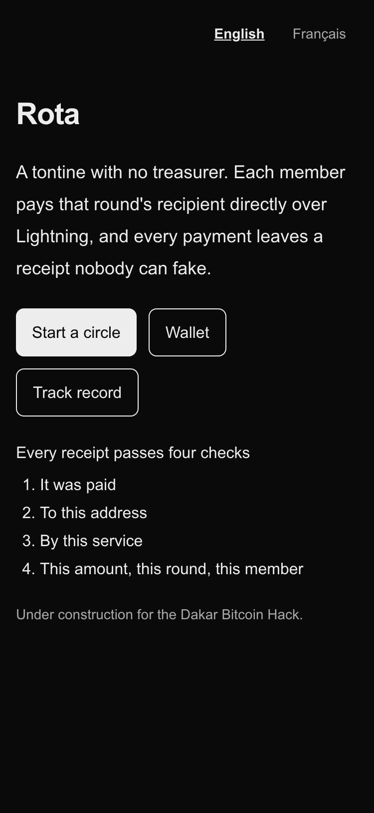
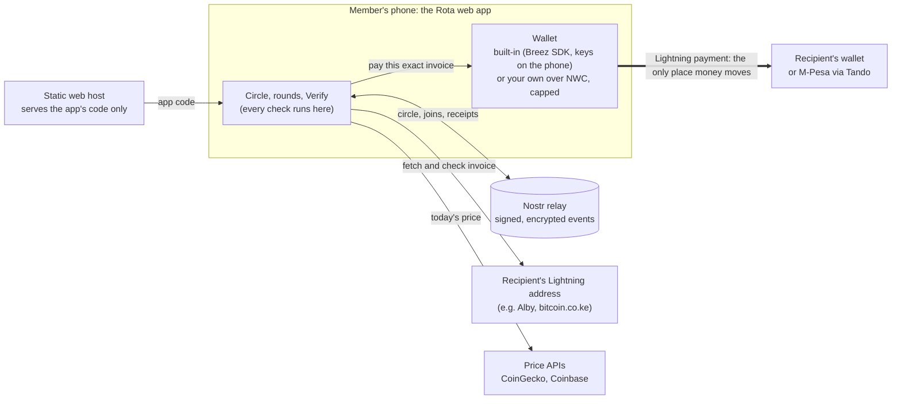

# Rota

A tontine (or chama) where nobody holds the pot. Each round, every member pays that round's recipient directly over Lightning, and every payment leaves a receipt anyone in the group can check on their own phone.

Built for the [Dakar Bitcoin Hack 2026](https://dakar-bitcoin-hack-2026.devpost.com/). MIT licensed.

> **Status, 18 Nov 2026:** the whole flow runs locally on regtest with a seeded demo circle: create a circle, join, pay, verify, settle, export a track record. Rota is built for mainnet with small amounts, but **no real mainnet payment has been made through it yet**, and the hosted demo isn't online yet. Both will be added here.

<p>
  
  
  
  
</p>

## The problem, and who it's for

Savings circles run on one person: a treasurer who collects everyone's money, keeps the notebook and hands over the pot. When that person is late, makes a mistake or disappears, the group has no record anyone trusts. Members abroad pay extra just to take part: sending $200 to Sub-Saharan Africa cost 7.9% on average in late 2023, the highest of any region ([World Bank, via Nairametrics](https://nairametrics.com/2024/06/30/diaspora-remittances-average-cost-of-sending-200-to-ssa-increases-to-7-9-in-2023-world-bank)).

Rota removes the treasurer's job instead of digitising it:

- **The organizer** sets up the circle (amount, schedule, seats) and shares one invite link. They never touch anyone's money. They are the first user.
- **Members** pay the round's recipient straight from their own wallet, on their own phone, at home or abroad.
- **Recipients** in Kenya can be paid to their M-Pesa number through `<number>@bitcoin.co.ke`, a Lightning address run by Tando. This is checked with unpaid invoices; a real payout hasn't been made yet.

I haven't run Rota with a real group yet, so this README gives no user or reach numbers.

## Try it locally (about 2 minutes)

Requires Docker with Compose.

```bash
docker compose up --build
```

```bash
docker compose logs seed
```

The first command starts the web app on http://localhost:3000 and a local Nostr relay (strfry) on ws://localhost:7777, both on this machine only. It also seeds a fictional circle: five members paying 1,000 KES a month, in round 3 of 5, with rounds 1 and 2 paid. The second command prints the circle's links:

1. Open **Baraka's** demo login (he still owes round 3) and press "Use this demo login".
2. The circle opens on round 3. Two of four members have paid.
3. Open round 1 and press **Verify** on any receipt to see its checks pass on your device.

Demo keys are public and the seeded payments never moved money, so the seed runs on regtest only. Paying from a demo login can't work locally: regtest has no Lightning, and the members' `@example.com` addresses don't answer.

Stop with `docker compose down`. Relay data is kept in a Docker volume; `docker compose down -v` removes it.

## How it works



- **There is no Rota server.** The host serves static files. There is no database, no accounts and no API routes.
- **The invoice is fetched and checked on the payer's phone,** from the recipient's own Lightning address, before anything is paid.
- **The relay stores only ciphertext.** Every circle event is NIP-44 encrypted for the circle, whose secret is in the invite link after `#`, which browsers never send to a server. The relay can drop events but can't read, forge or change them.
- **Wallets:** the built-in wallet (Breez SDK, Spark) keeps its recovery words sealed with the member's PIN on the phone. An outside wallet connects over Nostr Wallet Connect, and Rota accepts only a pay-only connection with a monthly budget of one contribution plus 25%, expiring at the cycle's end. The wallet enforces that budget, not Rota.

## How a receipt proves a payment

After paying, the member's phone signs a receipt with their own key and publishes it, encrypted, to the circle's relay. Every other member's phone checks it against the circle's own record, never against what the receipt claims:

| Check | Passes when |
|---|---|
| It was paid | SHA-256 of the preimage equals the invoice's payment hash. Only a real payment reveals the preimage. |
| To this address | The invoice commits to the hash of the recipient's LNURL metadata, which names their address |
| By this service | The invoice is signed by a node recorded for that address when the recipient joined |
| This amount, this round | Right network, the circle's contribution, and sats within ±20% of today's price |
| Signed by this member | The receipt is signed by a member of the circle |

The first four checks are the [`lightning-receipts`](packages/receipts) package, which is meant for any Lightning app.

**Limits, stated plainly:**
- **Copied receipts.** Members can decrypt each other's receipts, so one could copy another's invoice and preimage. Two claims on one payment show as "disputed" until the round's recipient signs a record saying who paid.
- **The weaker address proof.** bitcoin.co.ke signs a plain description ("Payment to …@bitcoin.co.ke") rather than the metadata hash, so its receipts pass the address check with the weaker proof, and the issuer check carries more weight.
- **A custodial address proves the service was paid.** When the address belongs to a service such as Tando, crediting the recipient's M-Pesa is that service's job.

## Security

The full threat model is in [THREAT_MODEL.md](THREAT_MODEL.md), with the code behind each defence. In short:

- **Rota never holds members' money** and never sees a recovery phrase.
- **With an NWC wallet, a fully compromised Rota can spend at most about 1.25 contributions a month per member,** until the connection expires.
- **With the built-in wallet, that cap doesn't hold against a compromised web host:** altered code could read the wallet when the PIN is typed. Keep about one contribution in it.
- **Error reports** (Sentry, off unless configured) are scrubbed on the phone first.
- **The site sends a Content-Security-Policy** (no `eval`; inline scripts are allowed for Next's bootstrap), and LNURL requests go only to public HTTPS hosts.

The known gaps, in order of risk: the built-in wallet against a compromised host, no key rotation for a leaked invite link, an open relay that can be flooded, the recipient's settlement being their word, and a track record that shows payments but not skipped ones.

## Compared with other savings circles in this hackathon

From each team's own Devpost page, read on 18 Nov 2026. Their claims, not tested by me.

| | Who holds money between payments | How payments are recorded | Network in the demo | Mobile money payout |
|---|---|---|---|---|
| **Rota** | No one: each member pays the recipient directly | Receipts signed by each member, checked on every member's phone | Regtest locally; mainnet build, no real payment yet | M-Pesa via `<number>@bitcoin.co.ke`, not yet paid out for real |
| [Natt](https://devpost.com/software/natt-lightning-tontines) | The server's Lightning wallet holds the pot until payout (stated in its threat model) | Nostr events signed with the group's key, chained | Simulated wallet that signs real BOLT11 invoices; LNbits for real sats | Not mentioned |
| [Twese](https://devpost.com/software/twese) | No one: hold invoices lock each payment until all are in, then release or refund | Payment hash per contribution in the app's history | Sandbox sats from an NWC test faucet | Planned (MTN MoMo, Wave) |
| [Ajo on Lightning](https://devpost.com/software/ajo-on-lightning) | The coordinator holds the pot between the last contribution and payout | Signed Nostr events with the preimage, rebuilt on a verify page | Test ledger and signet invoices | Not mentioned |
| [CircleSats](https://devpost.com/software/circlesats) | Not stated; contributions go to a receive-only receiver (NWC or LNbits) whose credentials stay on the server | Credited when the receiving provider reports the invoice settled | Public demo simulated; sandbox and Mutinynet tested locally | Not mentioned |

Twese's all-or-refund rounds use hold invoices, which nodes hold for only a few hours, so it collects during a meeting. Rota's rounds usually last a week or a month, so a member who doesn't pay leaves the recipient short, as with a cash tontine today; Rota makes the gap visible and provable.

## Constraints

- **M-Pesa payouts** through bitcoin.co.ke take 15 to 50,000 KES per payment (its LNURL range on 14 Nov 2026). Its invoices expire in 120 seconds, so the phone fetches one just before paying. Tando's fee isn't confirmed here.
- **Price moves.** Sats are worked out on each payer's phone at pay time, using Tando's own rate for bitcoin.co.ke addresses. Other members accept a receipt if its sats are within ±20% of today's price, so an old receipt can fail after a large move.
- **Members who stop paying.** Nothing forces a payment and nothing is refunded. The round shows who paid, who is pending and who is late.
- **The built-in wallet is a 5 MB download** (gzipped WebAssembly), fetched only when someone creates or unlocks it. NWC users never download it.
- **No reminders yet.** Members see the round's state when they open the circle.

## Metrics

Measured on 18 Nov 2026 on my Mac (Apple silicon).

| What | Number |
|---|---|
| Automated tests | 305 passing across six packages, plus 3 relay tests that run against a local relay |
| Cold `docker compose build` (no build cache) | 41 s |
| First load of a page, gzipped (HTML, JS, CSS, fonts) | 313 KB home, 319 KB circle, 347 KB wallet |
| Built-in wallet download (gzipped, on demand) | 5.0 MB |
| `lightning-receipts` package | 9 files, 7.7 KB packed |
| Tap to payment confirmed, tap to M-Pesa SMS | Measured after the first real payment |
| Load time on slow 3G | Not measured yet |

## Next steps

- Payouts to Wave and Orange Money through a licensed partner, for Senegal and the rest of the XOF zone.
- Reminders by SMS or USSD for members on feature phones.
- Wolof, after English and French.
- Rotating the circle's key when an invite link leaks, and write limits on the relay.

## Development

Requires Node 24 and pnpm 10.

```bash
pnpm install
pnpm dev        # the web app on http://localhost:3000
pnpm test       # all tests
pnpm typecheck
pnpm lint
pnpm build
```

| Folder | What it is |
|---|---|
| `apps/web` | The Next.js PWA (English and French) |
| `packages/receipts` | The receipt checker, `lightning-receipts` on npm: proves a Lightning payment reached a specific address ([its README](packages/receipts/README.md)) |
| `packages/circles` | The circle model, rounds and status, prices and LNURL-pay checks |
| `packages/wallet` | The built-in wallet's sealed vault, the payment guard and the NWC connection checks |
| `packages/records` | The circle on Nostr: events, relay access, rounds, settlements and track records |
| `scripts/seed` | The demo seed: publishes the fictional circle and prints its links (`pnpm --filter @rota/seed start` with the relay running) |

Rota's Nostr event kinds, none of them in the NIPs registry:

| Kind | Event |
|---|---|
| 3570 | A member's receipt for one payment |
| 3571 | The organizer's circle definition |
| 3572 | A member taking a seat |
| 3573 | The organizer's roster, fixing the seat order |
| 3574 | The recipient's "received" record, settling a disputed payment |
| 3575 | A member's track record (a file, not published to the relay) |

The relay test in `packages/records` runs only against a local relay: start it with `docker compose up -d relay`, then run `ROTA_TEST_RELAY=ws://127.0.0.1:7777 pnpm --filter @rota/records test`.

Decisions and their reasons are in [DECISIONS.md](DECISIONS.md).

## License

[MIT](LICENSE) · Made by Gregory Temwa Odete
